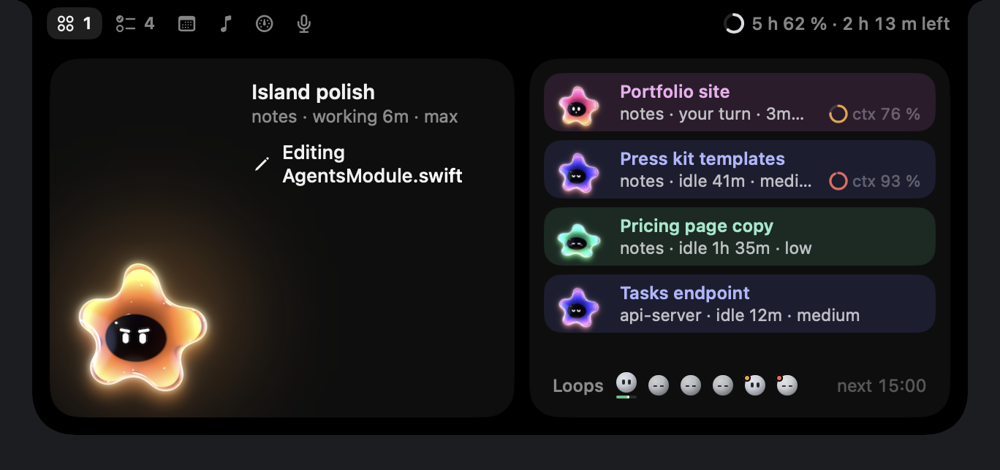
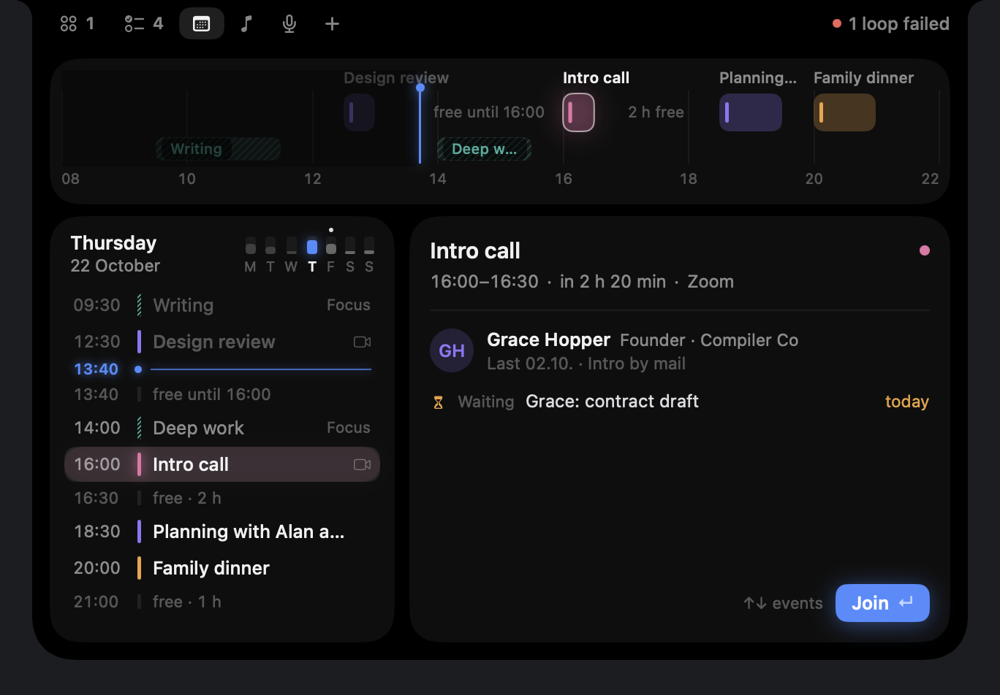
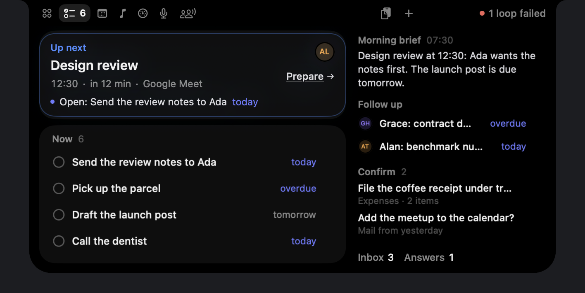
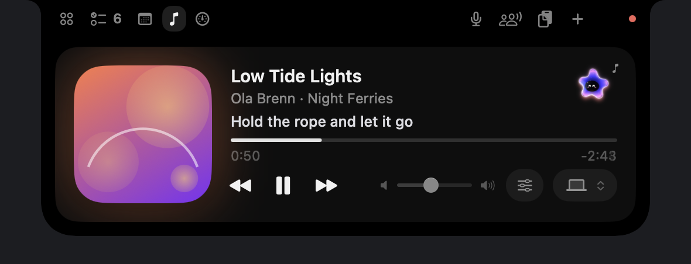
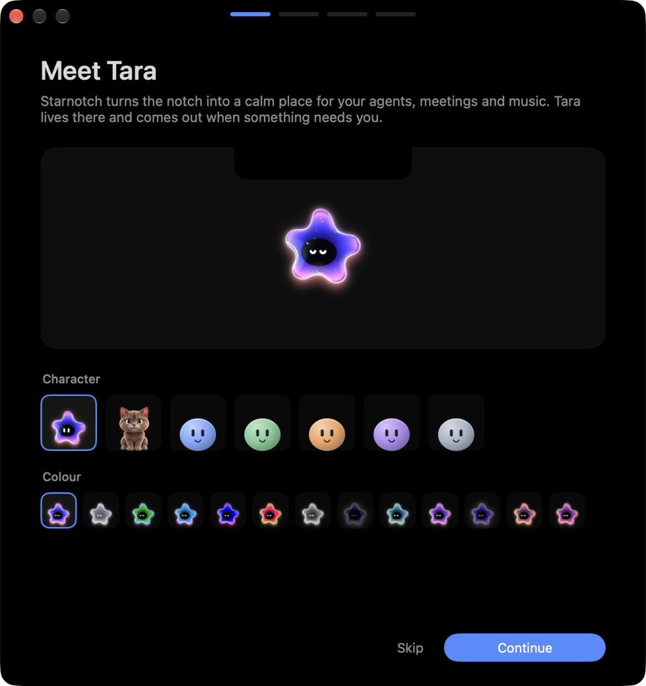

# Starnotch

**Your notch, the control strip for your agents.**

Meet Tara, a little star that lives in your MacBook's notch. Starnotch turns the notch into a small island. It shows what your coding agents are doing, your next meeting, what's playing, and anything a connector adds. Hover to peek, click to open, ⌃⌥Space from the keyboard, swipe on the notch to switch.

<p align="center">
  
</p>

## What it shows

| Module | What you see | Needs |
|---|---|---|
| **Agents** | Your Claude Code sessions as small characters: working, waiting for you, idle. Last steps, subagents, context window per session, plan limits in the header, recurring loops. | Claude Code |
| **Calendar** | Your day on a time band, the next meeting with a countdown and Join (Meet, Zoom, Teams), a reminder five minutes before. | Calendar access (asked when you first open it) |
| **Now playing** | Cover, controls, volume and output device for whatever plays: Spotify, Music, Podcasts, VLC, IINA, YouTube or SoundCloud in a browser. Optional: synced lyrics and a volume per app. | Nothing (Spotify or Music without the bundled helper) |
| **Dictate** | Starts Wispr Flow hands-free from the notch. | Wispr Flow |
| **Today** | Tasks, follow-ups and a short brief from a connector. | A connector |
| **Meeting** | Listens along and remembers your past meetings: flags when something said contradicts an earlier decision, nudges about open promises, writes down new ones, answers questions with the quote they come from. | An Anthropic API key; Reson8 for live audio, Jamie for past meetings |
| **Quick capture** | ⌃⌥N: one line out of the notch, dates and people recognised as you type (English and German). Everything lands in `Inbox.md`, ⌃⌥I opens it. | Nothing |
| **Command palette** | ⌃⌥K, or ⌘K while the island is open: one search over tabs, sessions, loops, today's events, tools, clipboard, shelf and settings. ↵ runs a row, ⌘↵ its second action; what you pick often comes first. | Nothing |
| **Agents inbox** | ⌃⌥A: everything that needs you, one at a time: permission prompts from Claude Code and Codex, MCP questions, sessions the Claude app says need you, finished turns, failed loops. The card in front stays until you move on. ↵ answers or opens, ⌘↵ jumps to the session, esc moves on. The count sits in the Agents ear. Comes with the Agents tab. | Claude Code or Codex |
| **Ask Tara** | ⌃⌥T or a click on the floating Tara: ask about your meetings, quick captures and notes; hold the keys to speak. The answer comes with its sources (meeting and date, the note), follow-ups keep the thread, esc closes. Drop her on a window to ask about it. | Claude Code on your plan or an API key (without one she only finds words); uv |

Modules whose source isn't on your Mac hide themselves. You can switch any module off in Settings.

<p align="center">
  
  
</p>
<p align="center">
  
</p>

On a display without a notch, the island is a small pill at the top center. Settings choose the display: the one with the notch, the main display, or the one with the pointer.

## Install

There are no signed releases yet. Build it yourself (a minute, no Xcode needed):

```sh
git clone https://github.com/juliokoelle/starnotch.git
cd starnotch
./scripts/build-app.sh          # -> build/Starnotch.app (signed ad hoc)
open build/Starnotch.app
```

Requires macOS 14 Sonoma or later and the Swift 6 toolchain (Xcode or just the Command Line Tools).

The first launch is one calm window with one card per step: meet Tara and pick her look, set up your agents, allow the calendar, allow the music players (only when the system-wide source can't be read), connect Jamie, choose how Tara thinks (your Claude subscription through Claude Code, your own API key, Apple Intelligence on this Mac, or simple rules), pick your notes folder, and switch on the tools you want. Each permission and connection says in one sentence why it asks and where the data stays; optional ones say so and can be skipped for now, and a granted permission turns its icon into a check. Everything is in Settings later, and nothing is set up until you click; open at login starts off. At the end Tara drops out of the notch with "Welcome to Starnotch" (left out with Reduce Motion), greets you in a speech bubble beside her and shows what she already found on this Mac: your agents, meetings in her memory, your notes and your next meeting.

<p align="center"></p>

## Set up in one click

The second step of the first launch lists the agents it found (Claude Code, Codex and the other agent tools) and exactly what it would set up: the Claude Code approvals plugin, the Codex approvals hook, the plan-limits status line (your current status line keeps running behind it), the MCP server and a small zsh snippet for long terminal commands. One button sets up everything, or switch items off first. The calendar and the players get a step each, and open at login sits with the tools. Nothing happens before that click; each change keeps a backup, and Settings › What's set up removes it again exactly. The one step left to you: trust the new hook once in Codex with `/hooks`. The menu bar's "Set up…" opens it again.

## Permissions

| What | Needed for | Without it |
|---|---|---|
| none | The island, hover, click, swipes, ⌃⌥Space, quick capture | — |
| Calendars | The calendar module | The module hides |
| Automation (Spotify, Music) | Now playing, only when the system-wide source isn't available (a build without the helper, or a macOS that blocks it) | The module stays quiet |
| System Audio Recording (optional) | Volume per app, asked the first time you move an app's slider | The mixer points to System Settings; apps keep their own volume |
| Accessibility (optional) | Escape cancels the wheel while you hold the notch over other apps; the open island ends between two menu bar icons instead of cutting one | Release in the center to cancel; the island keeps its fixed width |
| Automation (System Events, optional) | The dark mode switch in the System tab, asked the first time you use it | The switch flips back and the notch points to System Settings › Privacy & Security › Automation |
| Speech recognition and microphone (optional) | Speaking to Tara: hold ⌃⌥T or her mic button, asked the first time. Recognised on the Mac when the language allows it | Type the question |
| Screen Recording (optional) | Dropping Tara on a window to ask about it, asked the first time | She answers without the picture |
| Administrator password (once, optional) | Keep awake with the lid closed: installs `/etc/sudoers.d/starnotch-pmset`, which lets you run only `pmset -a disablesleep 1` and `0` without a password (checked by visudo first). Settings › What's set up removes it | Keep awake works only with the lid open |

## Privacy

Everything stays on your Mac. There is no telemetry and no account. The app reads Claude Code's and Codex's local session files read-only and never touches the Keychain. Connectors you add decide what they talk to. Synced lyrics, when you switch them on, ask LRCLIB (lrclib.net) with the track's title, artist, album and length. The Meeting module is the exception, and only while you run it: audio goes to Reson8 for transcription, the transcript and your meeting memory go to Anthropic's API. Once you connect Jamie, the app reads your meetings from your Jamie account on its own, every 30 minutes and after your meetings. Ask Tara sends your question, the meeting memory, your quick captures, any connector snapshots and, when you drop her on a window, its picture to the brain you chose (Claude Code on your plan, or Anthropic's API); with rules nothing leaves the Mac.

Settings › Tara's memory decides what she keeps: pause it (an hour, until midnight, or until you resume; also from the System tab, a mark on the notch shows it), switch single sources off (meetings and calendar, quick captures, notes vault, clipboard, agent sessions), keep apps out (password apps always), and delete what she remembers per source. If you let your AI apps read her memory (Claude Desktop, Claude Code, Cursor, ChatGPT's Mac app; a step of its own in the setup, off until you choose an app, and Settings › Tara's memory › Choose apps…), they get a read-only MCP server on this Mac that leaves out every source you switched off; what they do with an answer is up to them. While one is set up, the app keeps today's calendar (titles, times, places, attendees, join links) in its folder for that server; Ask Tara doesn't send it. Details: [agent/README.md](agent/README.md#taras-memory-in-every-ai-app).

## Now playing from any app

macOS 15.4 closed the MediaRemote framework to apps not signed by Apple. Starnotch therefore runs `/usr/bin/perl`, which macOS still lets through, and perl loads a small helper library inside the app (`helpers/mediaremote`, the technique of [mediaremote-adapter](https://github.com/ungive/mediaremote-adapter), BSD 3-Clause, rewritten). The helper only prints what plays to the app and passes play, pause, skip and seek on; nothing leaves the Mac. If a later macOS closes this door too, Starnotch falls back to Spotify and Music through AppleScript.

Volume per app uses CoreAudio process taps (macOS 14.2+), no audio driver: an app you turn down or up is muted at the source and played again at your level through a private aggregate device. Limits: it needs the System Audio Recording permission; a tapped app sounds a few milliseconds later; switching the output rebuilds the taps with a short gap; on an output with its own microphone (a headset, AirPods) the mixer leaves the microphone off and reads only the tap; apps that bring their own audio driver or take the device exclusively can't be tapped. Apps at 100 % run untouched.

## Plan limits and context

Claude Code hands your plan's 5-hour and weekly limits and each session's context window to its status line. A one-line bridge saves them for Starnotch: see [docs/usage-setup.md](docs/usage-setup.md).

## Approve from the notch

Claude Code's permission prompts ("Allow Bash: npm run build?") can show up in the island, so you answer without switching to the terminal: **Allow once** (↵), **Allow for session** (⌘↵, kept in memory until the session ends) or **Deny** (esc). The session's character waits next to the request.

It is a small Claude Code plugin in this repository. Install it once, from your shell:

```sh
claude plugin marketplace add /path/to/starnotch/integrations/claude-code
claude plugin install starnotch-approvals@starnotch
```

Restart running Claude Code sessions afterwards. To remove it:

```sh
claude plugin uninstall starnotch-approvals@starnotch
claude plugin marketplace remove starnotch
```

How it behaves:

- It never allows anything on its own. Only a click (or ↵ / ⌘↵) in the island allows.
- If Starnotch isn't running, or nobody answers within 60 seconds, the hook prints nothing and Claude Code asks in the terminal as usual. Answering in the terminal instead closes the card.
- The hook talks to the app over a Unix socket in `~/Library/Application Support/Starnotch/` (folder 0700, socket 0600); the app only serves processes of your own user. Nothing is logged or sent anywhere.
- "Allow for session" uses Claude Code's own suggestion for the rule where it has one (with `destination: session`); otherwise it allows exactly that Bash command, or that tool, for the session.

### Codex

Codex sessions (CLI, desktop app, IDE extension) show up next to Claude Code's without setup: the app reads `~/.codex` read-only (the thread list and each session's log). Sessions of one project share its character; a small badge (C, Cx) tells the tools apart, and the panel header shows both tools' plan limits, the one closest to its limit first. Settings › Providers switches each tool off.

Codex's permission prompts can come to the island too. The same hook script serves Codex; this adds it to `~/.codex/hooks.json` (with a backup) and removes it again:

```sh
integrations/claude-code/starnotch-approvals/codex/install-hook.sh
integrations/claude-code/starnotch-approvals/codex/install-hook.sh --remove
```

Then open `/hooks` in Codex once to trust the new hook. Codex can't take a rule for the whole session, so its card offers **Allow once** and **Deny** only.

## Other notch apps

Starnotch plays well with other notch apps, so you can try them side by side. Hold the notch and flick toward one of the four slots of the wheel. A slot holds a Starnotch module or another app, such as NotchNook, Boring Notch, Alcove or DynamicLake; choosing an app quits the apps in the other slots and opens it, so only one owns the notch at a time. Settings › Slots decides what sits where; the menu bar's "Open Wheel" opens the wheel without the gesture.

## Meeting agent

The Meeting module runs a small Python sidecar in [`agent/`](agent/README.md): Reson8 transcribes live, Claude compares what is said with your meeting memory, and the notch shows what matters, each card with its source. Past meetings come from Jamie or from meetings you saved. **Demo** plays a made-up meeting, no microphone or Reson8 needed.

```sh
cd agent && uv sync
export RESON8_API_KEY=…   # for live audio
```

Claude thinks on your own Claude plan through Claude Code when it's installed and signed in. Without Claude Code it uses `ANTHROPIC_API_KEY` if set, else simple rules; a Claude Code that isn't signed in to a Claude plan means rules, never the API by surprise (`STARNOTCH_BRAIN` picks, see [agent/README.md](agent/README.md#taras-brain)). Keys stay in your environment; nothing is stored in the repository.

## Configuration

`~/Library/Application Support/Starnotch/config.toml` is written on first launch with every option commented out: Claude Code's folder, which launchd jobs to show, the home project's character, the local API port, a Markdown file for quick capture, the interface language, and the connectors to run.

## Extend it

- **Connectors** bring your own data: a Today list, loops, people for meeting prep, a quick capture inbox. A connector is a small Swift package; see [docs/SDK.md](docs/SDK.md).
- **Character packs** add characters: a folder with a `manifest.json` and one PNG per state, optionally a look per effort level. Starnotch ships Tara, the Cat (its eyes show the effort) and Pebbles. See [docs/CHARACTER_PACKS.md](docs/CHARACTER_PACKS.md).
- **Local status API**: scripts post a line to the notch over `127.0.0.1` with a token, or with a `starnotch://status?title=…` link. See [docs/SDK.md](docs/SDK.md#local-status-api).

## Release

`RELEASING.md` has the steps for a signed, notarized release with a DMG, Sparkle updates and a Homebrew cask.

## Develop

```sh
./scripts/test.sh                          # unit tests (Swift Testing)
open build/Starnotch.app --args --sample-data  # test mode: made-up agents, day, music; asks for nothing
open build/Starnotch.app --args --preview usage --capturable   # fixed states for screenshots
```

```
Sources/NotchCore    pure logic, unit tested: geometry, parsers, config, the connector API
Sources/NotchKit     the app: island, modules, wheel, settings, onboarding
Sources/Starnotch    the app's executable (no connectors)
Resources/           app icon, the Pebbles character pack, interface strings (en, de)
```

See [CONTRIBUTING.md](CONTRIBUTING.md).

## License

The code is under the [Apache License 2.0](LICENSE), and so is the Pebbles character pack (drawn by `scripts/make-pebbles.swift`).

Tara (the default character) and the Cat are not: Copyright © 2026 Julio Koelle, all rights reserved. They may be used only as part of Starnotch as distributed by its authors. See the `LICENSE` file in `Resources/Characters/astra.notchpack`, `Resources/Characters/cat.notchpack`, `art/astra` and `art/cat`. Versions published before 29 October 2026 keep the Apache License 2.0 they came with.

Starnotch™ and Tara™, and the characters Tara and the Cat, are trademarks of Julio Koelle; a fork you distribute needs another name and no Tara or Cat. See [TRADEMARKS.md](TRADEMARKS.md).
